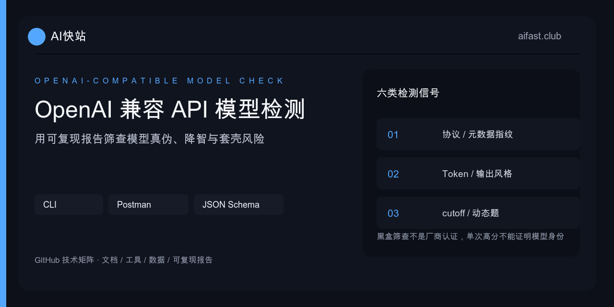

# 大模型 API 在线检测：规则与技术实现

[中文](README.md) · [English](README_EN.md) · [在线检测](https://docs.aifast.hk/model-check/?utm_source=github&utm_medium=repository&utm_campaign=model-check&utm_content=source-language-nav)

<p align="center"></p>

[](https://github.com/KKWANG4444/openai-compatible-api-check/actions/workflows/ci.yml)
[](https://nodejs.org/)
[](schema/report.schema.json)
[](LICENSE)
[](https://docs.aifast.hk/model-check/?utm_source=github&utm_medium=repository&utm_campaign=model-check&utm_content=cli-readme-badge)

本仓库公开在线检测使用的部分协议检查规则、报告结构和回归测试，供技术审计与方法复核。普通用户无需下载程序、安装 Node.js 或离开网站。

> 本工具由 AI快站维护，但检测计分与服务商无关。它不是 OpenAI、Anthropic、Google、DeepSeek 或其他模型厂商认证；结果只能描述检测时点的接口协议、可见元数据、Token 字段与行为样本，不能单独证明底层模型身份，也不能排除降智、套壳或动态路由。

## Gemini 4 Hydrogen / Carbon 接入更新（2026-11-17）

HK [上架公告](https://www.aifast.hk/api/announcements)已发布 `gemini-4-hydrogen`（11 月 13 日）和 `gemini-4-carbon`（11 月 11 日）。2026-11-17 [公开目录](https://www.aifast.hk/api/pricing)均标记 `available=true`，声明 `gemini`、`openai` 端点类型；OpenAI-compatible Base URL 保持 `https://www.aifast.hk/v1`。

检测 gemini-4-hydrogen 或 gemini-4-carbon 时仅选择 OpenAI Chat Completions 兼容端点；本工具不直接检测 Gemini 原生 generateContent，不改变计分或默认模型。 本次没有执行付费推理，目录记录不证明生成、SSE、工具调用或模型身份。

[Hydrogen / Carbon 分组与接入教程](https://docs.aifast.hk/providers/gemini-api/?utm_source=github&utm_medium=repository&utm_campaign=integration-guide&utm_content=aifast-model-check-kit-gemini) · [当前模型与价格](https://www.aifast.hk/pricing?utm_source=github&utm_medium=repository&utm_campaign=integration-guide&utm_content=aifast-model-check-kit-gemini-pricing)

## 直接在网站检测

[立即运行大模型 API 中转站检测](https://docs.aifast.hk/model-check/?utm_source=github&utm_medium=repository&utm_campaign=model-check&utm_content=source-readme-primary)

网站支持公开 HTTPS OpenAI Compatible API，可检查模型声明、Token、随机动态题、输出风格、知识边界、SSE 和工具调用，并继续查看分项结果。

[查看检测报告判读教程](https://docs.aifast.hk/guides/model-check-report-guide/?utm_source=github&utm_medium=repository&utm_campaign=model-check&utm_content=source-readme-report-guide)

Codex 自定义 Provider 使用 Responses API，不在当前 Chat Completions 在线检测范围内。配置 Codex 时应改用 [Codex API 中转配置教程](https://docs.aifast.hk/tools/codex/?utm_source=github&utm_medium=repository&utm_campaign=integration-guide&utm_content=source-readme-codex)和[Responses、工具调用、上下文压缩与会话恢复验收清单](https://docs.aifast.hk/troubleshooting/codex-gateway-checklist/?utm_source=github&utm_medium=repository&utm_campaign=integration-guide&utm_content=source-readme-codex-checklist)。

## 九项快速检查

| 检查项 | 权重 | 采集的证据 |
| --- | ---: | --- |
| 模型列表接口 | 10 | `GET /models` 状态码 |
| 模型 ID 可发现 | 5 | 目标模型是否出现在列表 |
| Chat Completions | 15 | 基础调用状态码和延迟 |
| 协议层合规 | 15 | `id`、`object`、`created`、`choices`、`message`、`finish_reason` |
| 固定指令遵循 | 15 | 本轮随机字符串是否被原样返回 |
| 元数据指纹 | 10 | model、request ID、system fingerprint 等可见线索 |
| 响应模型声明一致 | 10 | 请求与响应的 `model` 文本是否一致 |
| 计费 Token 字段 | 10 | 输入、输出和总 Token 是否为非负整数且算术一致 |
| R1 动态题 | 10 | 每轮随机多步计算答案与 nonce 是否精确匹配 |

具体证据含义、计分方式和模型真伪判断边界见[检测方法论](docs/methodology.md)。

## 深度检测档：thorough

CLI 和 GitHub Action 新增 `thorough` 检测档。在原有 3 次请求之外，再发起 3 次低额度探测：

- **SSE 流式事件**：检查 `text/event-stream`、每个 JSON chunk、delta、终止 `finish_reason` 和 `[DONE]`，识别“HTTP 200 但流被截断”的兼容问题。
- **工具调用结构**：发送不执行外部操作的最小函数工具，核对 `tool_calls` 或兼容的 `function_call`、函数名和可解析 JSON 参数。
- **错误响应契约**：使用随机不存在的模型 ID，要求返回 4xx 和结构化 `error.message`，避免网关静默回退到其他模型。

深度报告还给出本次样本的首个 SSE 事件、p50/p95 延迟。它们是一次性证据，不是 SLA；工具调用不支持时只降低深度证据分，不会把普通 Chat Completions 判为不可用。运行方式：

```bash
model-api-check --profile thorough --base-url https://api.example.com/v1 --model MODEL_ID
```

默认 `quick` 模式保持原有 3 次请求和 9 项必检门禁，适合低成本 CI；需要审核流式和工具调用时显式使用 `thorough`。

## 网站检测与技术证据

| 模式 | 请求量 | 适合场景 | 能力边界 |
| --- | ---: | --- | --- |
| [在线标准检测](https://docs.aifast.hk/model-check/) | 约 7 | 普通用户与开发者 | 交互式输出风格、知识边界、SSE、工具调用等证据 |
| GitHub Action | 3 | 部署门禁与定时巡检 | 核对模型列表、Chat Completions、协议、Token 与动态题，失败时阻断工作流 |
| GitHub Action thorough | 6 | 发布前深度验收 | 9 项核心门禁 + SSE、工具调用、错误契约和延迟样本 |
| 仓库回归测试 | 3/6 | 维护者审查规则 | quick 与 thorough 均有本机模拟回归测试 |

网站结果用于兼容性与风险筛查，不是模型厂商认证。不同时间、地区、模型和参数的结果不应直接横向比较。

## 报告与证据复用

- [JSON Schema v2](schema/report.schema.json)
- [示例 JSON 报告](examples/report.example.json)
- [报告字段说明](docs/report-schema.md)
- [检测方法论](docs/methodology.md)
- [机器可读摘要](llms.txt)
- [机器可读完整说明](llms-full.txt)

公开报告前请移除业务输入、用户数据和可关联内部系统的 request ID。模型声明、system fingerprint 与 request ID 都可能被网关改写，应作为交叉核对线索，而不是身份凭证。

## 安全与使用边界

- 公开目标只接受 HTTPS，不接受 URL 内嵌账号、密码、查询参数或片段。
- 在线检测只接受公网可解析的 HTTPS 目标，不接受本机、私网、链路本地及保留地址。
- CLI 使用 Node 内置地址规则识别 IPv4 映射 IPv6；每次连接仅使用同次校验过的 DNS 结果，不跟随重定向，保留 TLS 证书校验。单次响应上限为 8 MiB。
- 不要在 Issue、截图或公开报告中提交 API Key；建议使用临时限额 Key 并在检测后撤销。
- GitHub Docker Action会按平台要求把输入传入容器启动参数；API Key必须来自GitHub Secrets，并只在可信Runner上运行，避免将密钥直接写进工作流或共享日志。
- 工具不会绕过认证、限流或访问控制。
- 单轮通过不代表生产稳定；应继续测试并发、样本量、成功率、P50/P95、状态码分布、账单和服务条款。
- 发现密钥泄露、请求越权等问题时，请使用 GitHub Security Advisory 私下报告。

## AI快站技术矩阵

| 需求 | 入口 |
| --- | --- |
| 检测、迁移、排错与工具配置总入口 | [AI快站开发者中心](https://github.com/KKWANG4444/aifast-developer-hub) |
| 浏览器运行 10 维标准检测 | [大模型 API 中转站检测](https://docs.aifast.hk/model-check/?utm_source=github&utm_medium=repository&utm_campaign=model-check&utm_content=cli-readme-online-check) |
| 判读检测报告与风险边界 | [网站报告判读](https://docs.aifast.hk/guides/model-check-report-guide/?utm_source=github&utm_medium=repository&utm_campaign=model-check&utm_content=source-matrix-report-guide) |
| 排查 `/v1/v1`、404 与完整端点误填 | [Base URL 检查器](https://docs.aifast.hk/tools/base-url-checker/?utm_source=github&utm_medium=repository&utm_campaign=developer_acquisition&utm_content=source-matrix-base-url-checker) |
| 估算 Token、批量任务与重试成本 | [Token 成本计算器](https://docs.aifast.hk/tools/api-cost-calculator/?utm_source=github&utm_medium=repository&utm_campaign=developer_acquisition&utm_content=source-matrix-api-cost-calculator) |
| 配置和验收 Codex Responses API | [Codex API 配置与排错](https://docs.aifast.hk/tools/codex/?utm_source=github&utm_medium=repository&utm_campaign=integration-guide&utm_content=source-matrix-codex) |
| OpenAI Compatible 迁移与排错 | [生产接入与 API Doctor](https://github.com/KKWANG4444/llm-api-proxy-china) |
| Cursor、Dify、Claude Code 等配置 | [开发工具接入指南](https://github.com/KKWANG4444/ai-api-proxy-china-guide) |
| 成功率、P50/P95 与错误分布 | [稳定性监控方法](https://github.com/KKWANG4444/AI-API-Stability-Tracker) |
| 500+ 模型目录、维护信息与证据 | [AI API 状态与证据中心](https://github.com/KKWANG4444/api-status) |

AI快站公开的当前运营口径包括 500+ 国内外模型统一接入、国外模型国内直连、高速稳定线路、99% 模型可用性和企业发票支持；其中 99% 不是本仓库测试结果，也不等同于合同 SLA。实际接入请以[官网](https://www.aifast.hk/?utm_source=github&utm_medium=repository&utm_campaign=integration-guide&utm_content=source-readme-footer-website)与[控制台模型价格](https://www.aifast.hk/pricing?utm_source=github&utm_medium=repository&utm_campaign=integration-guide&utm_content=source-readme-footer-pricing)的当前展示为准。

## 本地验证

```bash
npm ci
npm run verify
```

该命令供仓库维护者验证检测规则和报告结构。

## 在 GitHub Actions 持续验收

如果你的应用依赖某个 OpenAI Compatible 网关，可以在部署或定时任务里直接运行本仓库的 Action。先在仓库 Settings → Secrets and variables → Actions 中创建名为 `LLM_API_KEY` 的 Secret，不要把密钥直接写进工作流文件。

```yaml
name: LLM gateway check

on:
  workflow_dispatch:
  schedule:
    - cron: "17 */6 * * *"

jobs:
  check:
    runs-on: ubuntu-latest
    steps:
      - uses: actions/checkout@v4
      - name: Check OpenAI-compatible endpoint
        id: api-check
        uses: KKWANG4444/openai-compatible-api-check@v1.1.0
        with:
          base-url: https://api.example.com/v1
          model: your-exact-model-id
          api-key: ${{ secrets.LLM_API_KEY }}
          profile: thorough
      - uses: actions/upload-artifact@v4
        if: always()
        with:
          name: openai-compatible-api-report
          path: ${{ steps.api-check.outputs.report-path }}
          if-no-files-found: error
```

协议检测执行完成但有必检项未通过时，步骤返回非零状态，工作流会变红；此时脱敏后的 Markdown 报告会写入 Job Summary，也可以作为 Artifact 保存。若在参数校验或DNS解析阶段提前终止，则不会生成检测报告，错误原因会直接显示在步骤日志中。Action 不接受命令行明文密钥，报告生成前会对上游回显的密钥做替换。

示例固定到 `v1.1.0`，便于复现；`v1` 是跟随已验收补丁的主版本别名。quick 模式修复映射 IPv6 私网校验和第二次生成响应漏检；thorough 模式进一步核对 SSE 终止、工具参数和错误契约。任何核心必检项失败都显示“需要排查”，错误或溢出的 Token 不进入汇总。thorough 的额外检查是能力证据，不会把不支持工具调用的服务误写成 Chat 协议完全失败。

首次接入可先用[浏览器在线检测](https://docs.aifast.hk/model-check/?utm_source=github&utm_medium=repository&utm_campaign=model-check&utm_content=readme-action-section)确认 Base URL 和模型 ID，再把稳定的验收参数放进 CI。

## 相关技术资源

- [AI快站开发者中心](https://github.com/KKWANG4444/aifast-developer-hub)：迁移、排错与客户端配置总入口。
- [AI API Stability Tracker](https://github.com/KKWANG4444/AI-API-Stability-Tracker)：把多次请求汇总为成功率、P50/P95 和错误分布。
- [模型状态与证据中心](https://github.com/KKWANG4444/api-status)：状态页、兼容性页面与机器可读证据。

> ⭐ 如果这个 CI 验收工具帮到了你，欢迎给仓库点个 Star。

## 许可证

MIT

## .hk 模型目录同步与检测边界（2026-11-23）

本次按 https://www.aifast.hk/api/pricing 与 https://www.aifast.hk/api/announcements 复核。公开目录当前约 322 条模型记录，模型数量会变化，不应把目录总数当作在线检测通过数。

**可直接进入本检测器的模型示例：** qwen4-max、gpt-6.2-astra、gpt-6.2-sol、hy4-flash、gemini-4-hydrogen、gemini-4-carbon、claude-fable-5-2。前提是当前账号目录返回该精确 ID，并选择 OpenAI-compatible Chat Completions 端点；gemini、anthropic、Responses 或厂商原生端点不由本检测器自动改写。

**专用端点不属于当前 Chat Completions 检测范围：** scribe_v2、scribe_v3（语音转文字）、doubao-seedance-2-5-flash-261115（视频）和 doubao-seedream-5-5-261028（图像）。这些模型应按对应端点和字段单独验收，不要把检测失败解释为模型不可用。

**状态提示：** 公告显示 gemini-3.8-flash 和 gemini-4-argon 曾临时下架；调用前必须重新读取当前目录、公告和账号权限。目录收录不等于生成、SSE、工具调用或模型身份已验证。
